# tarcsweb

Claude Code and Codex in one browser tab, running on your own computer.

tarcsweb shows each agent session as a tab in your browser. A tab runs on Claude
Code (through the Agent SDK) or on Codex (through its app-server), and you can
keep both kinds open side by side. Replies render as markdown, every file edit
becomes a diff card you can open, and subagents report their progress in a panel
of their own. It uses the `claude` and `codex` CLIs you already signed in to, so
your subscriptions, skills, hooks, CLAUDE.md and AGENTS.md files and MCP servers
work the same way they do in the terminal. You need only one of the two.

tarcsweb is opinionated. Each feature began as a fix for something that kept
getting in the way during long days of work with coding agents. The sections
below name the problem behind each one, so you can tell whether it fits the way
you work.

[](#install)
[](https://www.npmjs.com/package/tarcsweb)
[](#what-you-get)
[](#uninstall)
[](LICENSE)

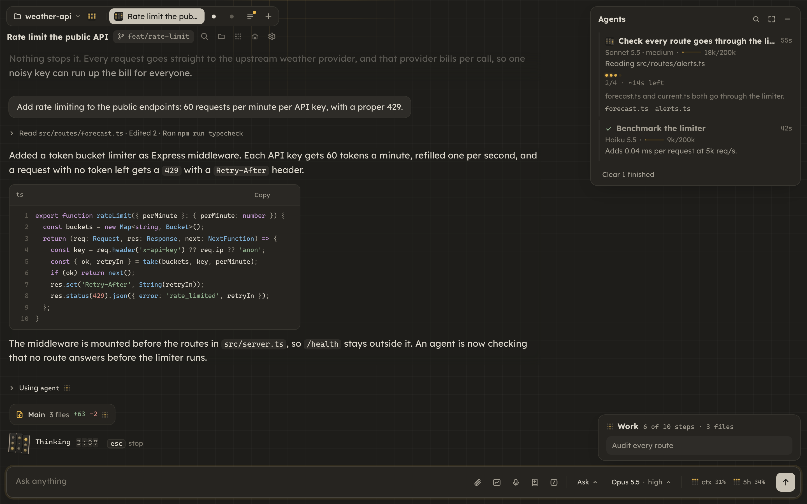

## Install

If you have Node, run the installer from npm:

```sh
npx tarcsweb
```

Without Node, use curl:

```sh
curl -fsSL https://raw.githubusercontent.com/TLucas97/tarcsweb/main/get.sh | bash
```

Both commands run the same installer, and running either one again updates tarcsweb to the latest release. The [`tarcsweb` package on npm](https://www.npmjs.com/package/tarcsweb) holds only that installer; the app itself comes from the GitHub releases.

The installer runs tarcsweb as a background service on http://localhost:24816
and opens it in your browser when it finishes. It also adds a `tarcsweb` command
and an app menu entry, so you can open it again later.

You need:

- Linux with a systemd user session, macOS, or Windows through WSL2
- Node 26 or newer and pnpm (the installer offers to install both)
- at least one agent: the `claude` CLI signed in to your claude.ai account, or the `codex` CLI (`npm install -g @openai/codex`), which you sign in to with ChatGPT from the app

<details>
<summary>Read the script before running it</summary>

```sh
curl -fsSLO https://raw.githubusercontent.com/TLucas97/tarcsweb/main/get.sh
less get.sh
bash get.sh
```

</details>

<details>
<summary>What the installer does, step by step</summary>

`get.sh` downloads the latest release into `~/.local/share/tarcsweb/releases/<version>` and runs that release's `install.sh`, which installs the dependencies, builds the client and starts the service. On Linux the service is the systemd user unit `tarcsweb`; on macOS it is the launchd agent `io.github.tlucas97.tarcsweb`. Spoken recaps (Kokoro TTS, about 350 MB) and phone notifications through ntfy are optional, and the installer asks before setting them up.

To install a given version, pass it along: `npx tarcsweb v0.5.3`, `bash get.sh v0.5.3`, or `curl ... | bash -s -- v0.5.3`. `--yes` answers yes to the installer's questions. `TARCSWEB_PORT` picks another port. Running the installer again is safe.

Optional: the Browser panel needs a Chrome or Chromium, plus Xvfb on Linux and ffmpeg for recordings (see [Browser panel](#browser-panel)).

Optional: concept drawings in the explain panel need `rsvg-convert` (`brew install librsvg` on macOS, `librsvg2-bin` on Debian/Ubuntu, `librsvg` on Arch/Fedora).

</details>

<details>
<summary>Notes for macOS</summary>

- Run the installer in Terminal while you are logged in at the Mac. The service lives in your login session, so it starts when you log in and stops when you log out.
- macOS leaves `~/.local/bin` off your PATH, and the installer prints the line that adds it: `echo 'export PATH="$HOME/.local/bin:$PATH"' >> ~/.zprofile`. Spotlight finds `tarcsweb.app` either way.
- Logs go to `~/Library/Logs/tarcsweb/tarcsweb.log`. Restart the app with `launchctl kickstart -k gui/$(id -u)/io.github.tlucas97.tarcsweb`.
- Voice input and spoken recaps need Python. Run `xcode-select --install` first, and `brew install python` for spoken recaps, which need Python 3.10 or newer.
- Voice input has not been tested on a Mac yet. If dictation fails, check for tarcsweb or node under System Settings > Privacy & Security > Microphone.

</details>

<details>
<summary>Notes for Windows (WSL2)</summary>

- tarcsweb runs inside WSL2, and you open http://localhost:24816 in your Windows browser.
- The service needs systemd, which WSL leaves off unless `/etc/wsl.conf` turns it on. In the Ubuntu terminal, run `printf '\n[boot]\nsystemd=true\n' | sudo tee -a /etc/wsl.conf`, then `wsl --shutdown` in Windows PowerShell, and open Ubuntu again. `ps -p 1 -o comm=` should print `systemd`. The installer prints these steps when systemd is off.
- WSL stops its Linux VM a little after the last WSL window closes, and tarcsweb stops with it. Keep a WSL terminal open while you use it.
- The installer cannot open the Windows browser, so open the address yourself when it finishes.

</details>

## What you get

### Sessions as tabs

Every conversation is a tab in the dock at the top. Ctrl+K (Cmd+K on a Mac) opens a palette that finds any session by folder or title: Enter resumes it, or you start a new session in that folder. Typing also searches the text of past conversations, Claude and Codex alike, and shows the matching line under each hit. For a vaguer question, the Ask AI row has Haiku pick the sessions that fit and say why. Right-click a tab to rename, reload or close it.

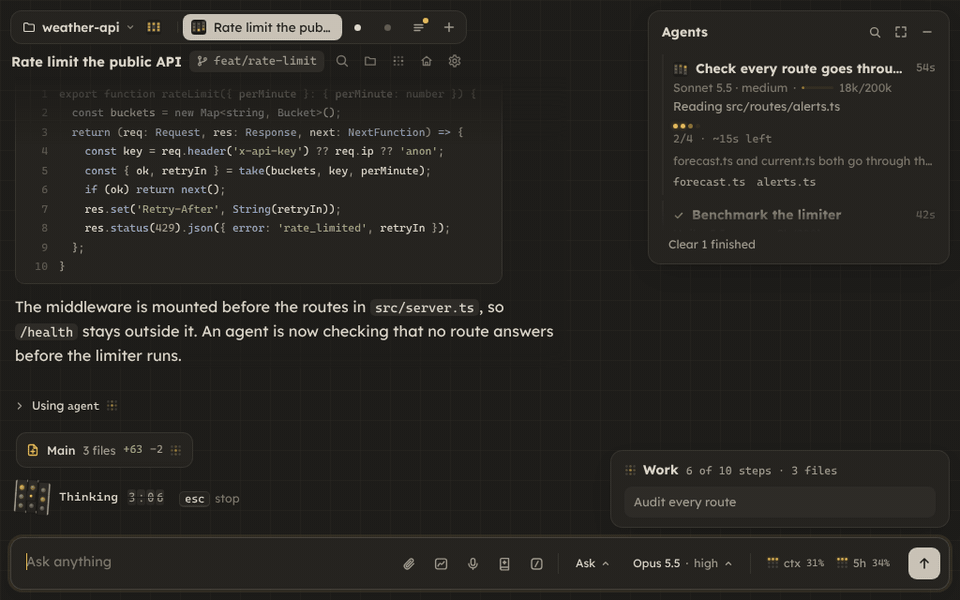

A resumed session scrolls back to its very first message, older messages load in pages as you scroll up, and Find searches the whole session, including the parts not loaded yet.

### Short replies that grow when you click

People skim long replies, and the part you needed is often the part you skipped. So replies arrive short. Each underlined phrase holds more detail, and a click grows it in place, right where you are reading. Claude is told which parts you opened. If you prefer full answers with a short summary on top, switch Replies to Summary in Settings > Appearance.

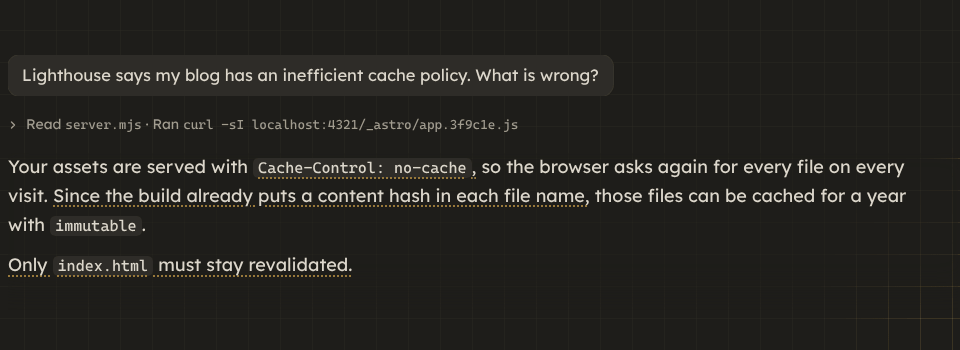

### Every file change, as a diff

Each agent that edits files gets a diff card per turn. A click opens the full diff, with every file of that turn and a switch between split and unified views.

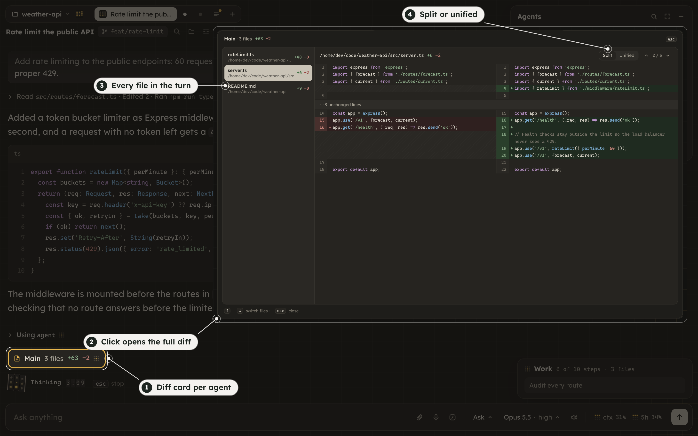

### Answers with visuals

Claude can answer with charts, stats, tables, checklists, timelines, diagrams, file lists and before and after comparisons, drawn inside the reply. It can also render custom pictures and paged replays that walk you through a change. A replay's Listen button records a spoken summary of the whole replay that explains, in plain words, what it shows and why it matters.

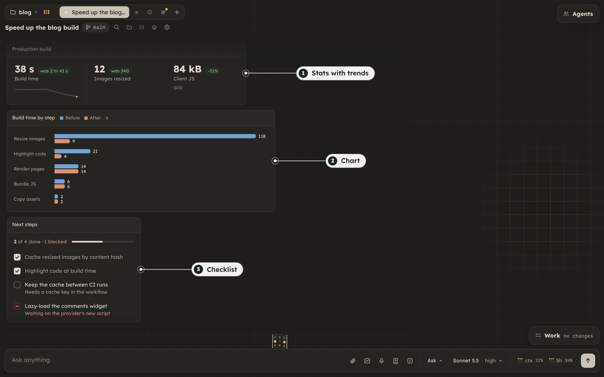

### Questions as cards

When Claude needs decisions from you, the questions arrive together in one card. Each one can mark a recommended option and say why. Pick an option or write your own answer, then send the whole round at once. If you would rather talk it through first, Reply in chat closes the card and Claude waits for your message.

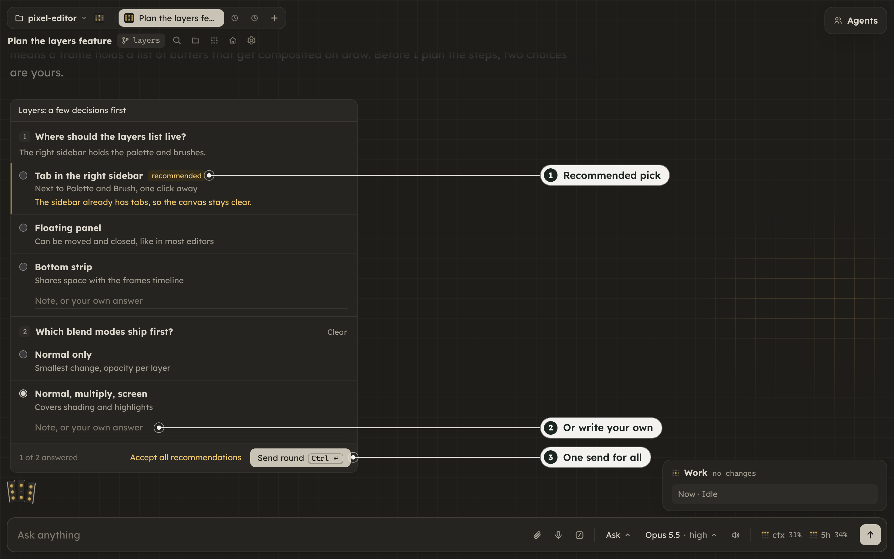

### Agents and their work

The Agents panel lists the main thread and every subagent with its model, effort, tokens and progress, and each one has a stop button. The Work panel keeps one live checklist per agent and every file changed in the session.

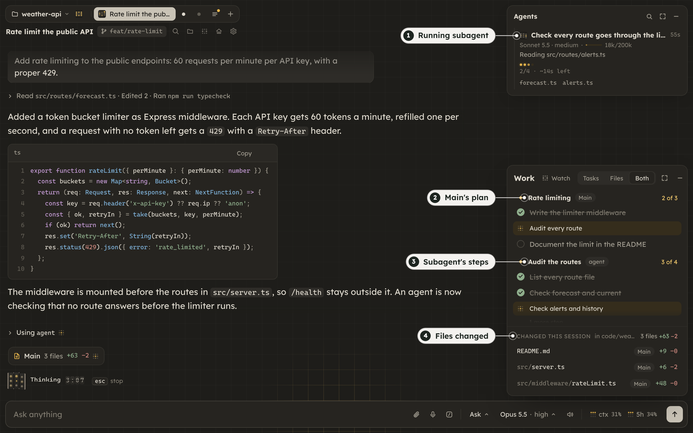

### Claude and Codex side by side

A review from a second model often catches what the first one missed. With the `codex` CLI installed and signed in from Settings > Account (Sign in with ChatGPT), the model menu lists Claude and Codex models together. Pick a Codex model and the tab runs on Codex, with the same visuals, questions, Agents panel and diff cards. Your Codex threads from `~/.codex/sessions` show in Ctrl+K and resume as tabs. Switching a tab's provider opens a new tab with a handoff.

The two also work for each other. Claude can hand a task to a Codex agent that runs in the background, shows in the Agents panel with its own progress, asks for permission like Claude does, and reports back when it ends. A Codex tab can start Claude agents the same way. Claude can also generate images with Codex; the reply shows a running clock, then the images, saved to `AI Images` on your desktop.

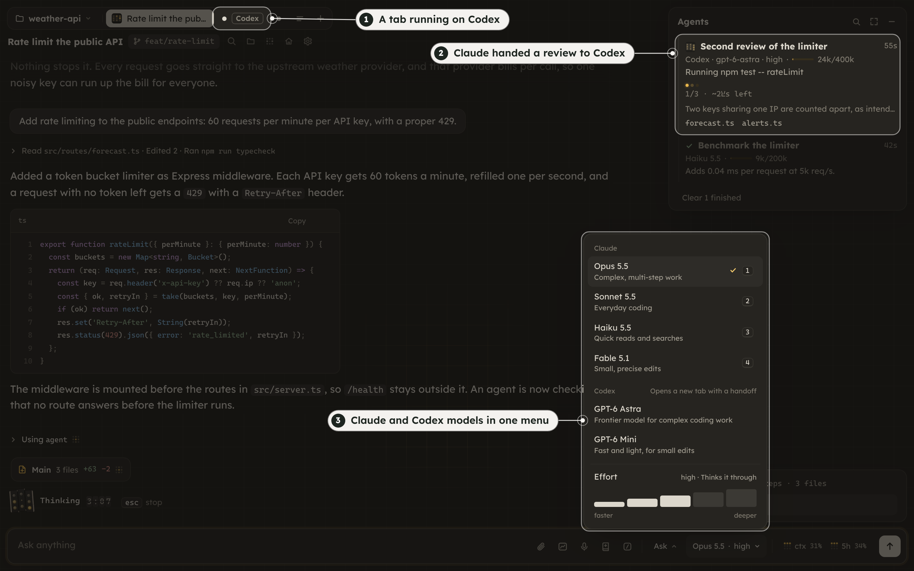

### Watch mode

After a long run, reading the transcript from the top can take longer than the run did. Watch mode plays the session back as a small robot walking through its plan, step by step, with a lane for each subagent. At each step, the agent's work grows as a line that climbs up and to the right like a subway map: every folder it visited is a stop, and the files it read or edited branch off that stop. Each subagent gets a box with its own line, and a Tree | Cells switch in the header brings back the older cell view. It works live and from any point in the history. Commands read as the agent described them, and a failed one shows the line of output that says why. Each subagent's lane follows its own calls, live or from history. A side panel lists one agent's actions up to the playhead, or every file each agent touched, and checks such as typecheck, tests and build show as pills with how they stand. Opening watch mode first catches you up on what happened since you last looked.

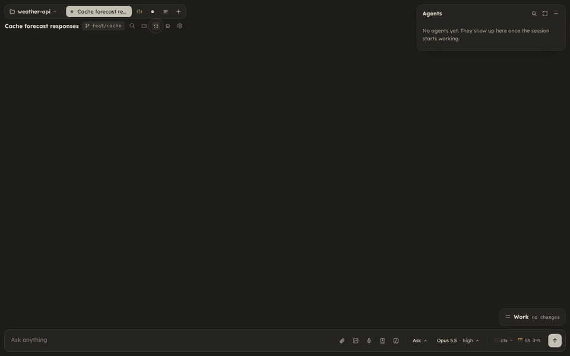

### Skills library

With a few dozen skills installed, it is easy to forget the one that fits the task in front of you, and a skill nobody remembers never loads. The skills button next to the message box lists every skill Claude Code and Codex can load: your own, the project's, plugins, skills synced from claude.ai, and Codex's. It groups them by where they come from, searches them, and links to their source. A click attaches a skill to your next message as a chip. Suggest asks a small model which skills fit what you are writing, and Organize finds the authors of skills that do not name one, without changing any skill file. Chips beside the button show the skills the session has loaded right now.

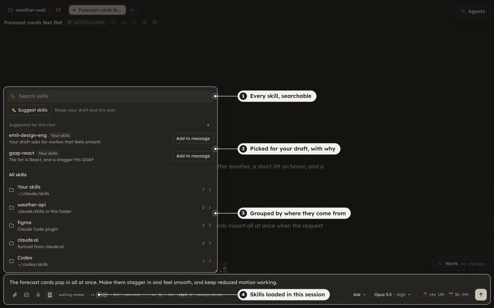

### Session widgets

With two or three sessions running at once, checking on each one means leaving the one you are working in. Up to three sessions, open or past, can instead float over the window as small live chats. Open one from a tab's right-click menu, the Ctrl+K palette or a folder's session list, then read along and reply without leaving the session you are in. A widget folds into a bubble with the session's robot and a badge when it needs you, and you can drag, fling and resize it.

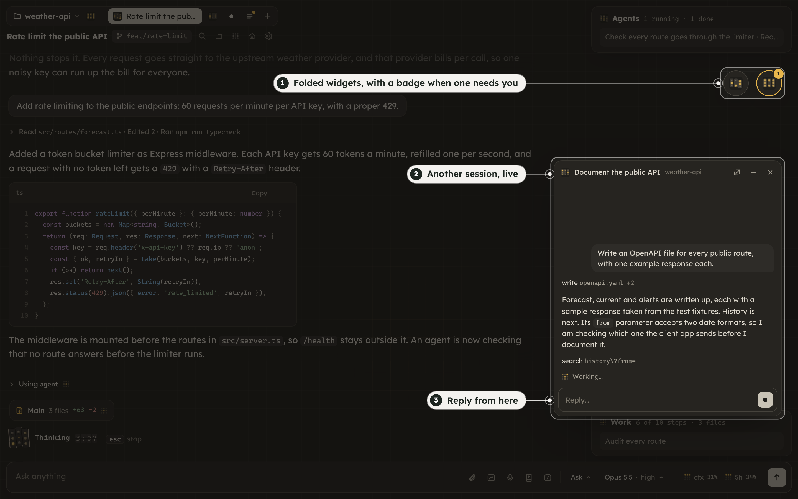

### Drawing board

Some requests are faster to draw than to describe: where a panel goes, how a screen is laid out, how steps connect. The Drawing board button next to the paperclip opens a canvas for sketching screens and flows. It has a pencil, an eraser that cuts strokes where it passes, a lasso, text, rectangles, ellipses, lines and arrows that follow the path you draw, with colors, widths, dashes and fills. Hold the pointer still at the end of a stroke and a rough shape snaps to a clean line, ellipse, rectangle or polygon. Pictures can be pasted or dropped onto the canvas.

Draw a lasso around part of the sketch, say what you want, and Codex or Claude redraws that part as shapes and text you can still move and edit. A lasso around an empty area draws something new there. The model sees the whole drawing for context, and you pick the model and effort for each request. These requests run without your AGENTS.md or CLAUDE.md, MCP servers, skills or tools.

Send board, in the top right corner, attaches the whole drawing to your message as an image, and Send to chat in a selection's bar attaches only that selection. A toolbar toggle decides whether a finished shape or text stays selected, ready to move. The drawing stays until the page reloads, and the board remembers your last styles and eraser size.

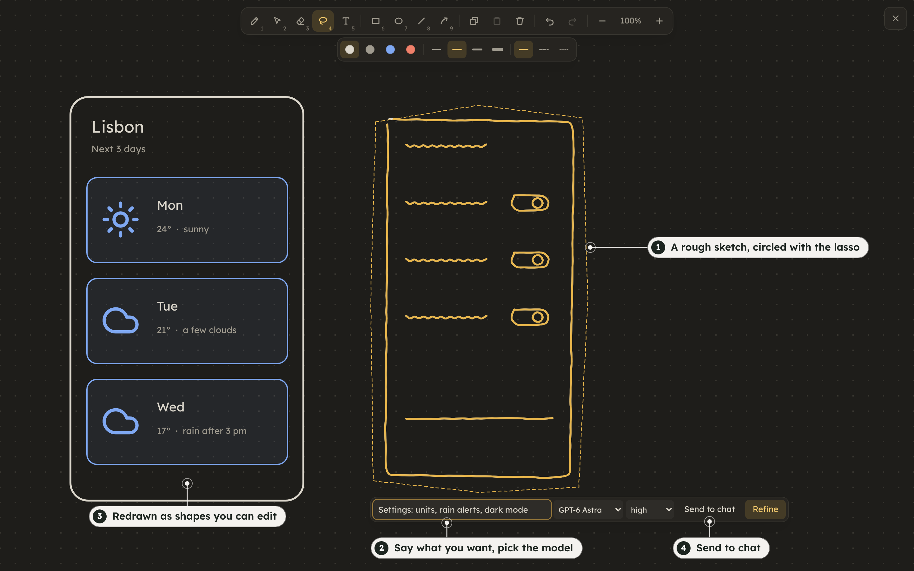

### Browser panel

An agent that tests a web app usually drives your own Chrome, with your tabs and logins, while you are trying to use it. The globe button at the top opens a Browser panel instead. It is a separate Chrome with its own profile, streamed into tarcsweb, and you can click and type in it yourself. On Linux it runs on a private Xvfb display, so no window appears on your desktop, and on macOS it runs headless. Its sound is always muted. It starts when something needs it and stops after a while without use.

Agents reach it in three ways. Playwright (panel) and DevTools (panel) are two built-in MCP packs that connect to its DevTools port, and Claude in Chrome works there once you install and sign in to the extension, which a setup card walks you through. The Agents switch in the panel's header is off by default. While it is off, agents never start or use the panel, and Claude in Chrome behaves as it does in plain Claude Code. With it on, new sessions get both panel packs, browser work goes to the panel, and longer browser tasks go to a browser subagent that runs on Sonnet by default. A Claude in Chrome call aimed at another browser is refused, and the agent is told why.

The record button saves the active tab as an MP4 with the agent's cursor drawn in, and agents can record through the `browser_record` tool. The Recordings list in the header plays and deletes them, and the app keeps the newest 20 for up to 7 days. Two optional skills come with the panel. `learn-app` walks through the project's app and writes a QA playbook for it, and `validate-pr` checks a pull request out in a separate worktree, tests the flows it changes in the panel and records the run. The menu at the end of the address bar puts either one in the message box.

The panel needs a Chrome or Chromium. On Linux it finds Google Chrome (native or Flatpak), Chromium, or Playwright's Chrome for Testing, and on macOS it uses Google Chrome. `browser.bin` in the config file or `CW_BROWSER_BIN` picks another binary. On Linux, also install Xvfb (`xvfb` on Debian/Ubuntu, `xorg-server-xvfb` on Arch, `xorg-x11-server-Xvfb` on Fedora). Without it the panel runs headless, and Claude in Chrome then uses your own Chrome, as it does on macOS. Recordings need ffmpeg.

### Lite mode

Slower computers can turn on Lite in Settings > Appearance. The layout stays the same and the parts that run on their own stop: the robot and other ambient animations, the live background, and visual replies, which show a still image until you press Play live. The background helpers stop too. No `claude` process stays warm between messages, dictation loads when you open the mic, and tab titles come from your first words instead of a model call. Summaries, side notes, watch mode and spoken recaps are off while Lite is on. On a 2-core machine with 4 GB and no GPU, the app was ready in 1.1 s instead of 3.7 s.

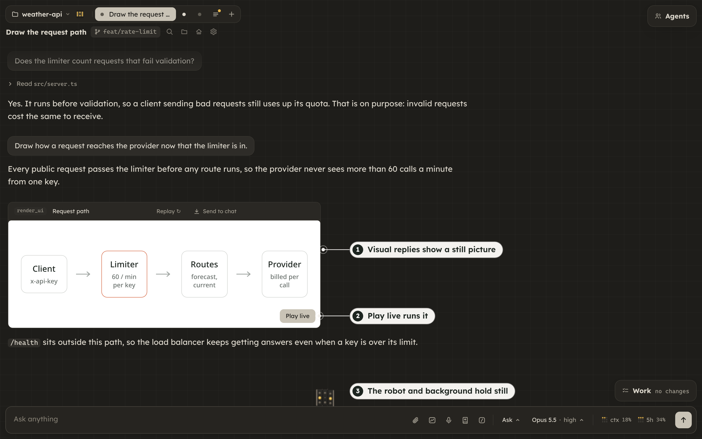

A fresh install checks the computer's memory, cores and graphics and offers Lite once if they look slow. `CW_PROFILE=lite` in the service environment forces it.

### And also

- Voice input: hold Space in the message box, or click the mic, and talk. Claude Code's own dictation transcribes it, so it needs python3 and a claude.ai sign-in. It is experimental.
- Listen: each reply has a button that reads a short spoken recap of it aloud (needs the optional Kokoro install). Recaps and replay summaries play in a player at the top of the window, with seeking, speeds from 1x to 3x and your keyboard's media keys.
- Remote Control: right-click a tab to continue that session from the Claude app on your phone or from claude.ai/code. It needs a Pro or Max plan.
- Phone notifications through ntfy when a session waits for you or a long turn ends.
- Side notes: Claude Code's built-in You should know mod is on in tarcsweb sessions. A side agent reads the session and adds heads-up notes about things you or Claude might miss. It counts toward your plan's usage, and Settings > Context turns it off. Lite mode turns it off too.
- Skills that come with the app: `replay` and `visual-explainer` guide the replays and pictures, `grilling` runs a round of hard questions about a plan, and `learn-app` and `validate-pr` test an app in the Browser panel. They load only in tarcsweb sessions and leave `~/.claude` alone.
- Linked attachments: attachments in the message tray are numbered. Select words in your message and link them to one, and Claude reads which attachment those words refer to.
- Turns the agent starts on its own, after a background agent or command finishes, get an Update header that says what woke it.
- A short tour of the main features with a recorded clip for each chapter, offered on a first open and kept in Settings > Tour.
- Permission asks, mode, model and effort menus, an MCP menu, a usage meter, a file tree, an image viewer, guided reading, and a bar over any text you select in a reply to copy it, explain it or attach it to your next message.

## Settings

The gear at the top left opens Settings.

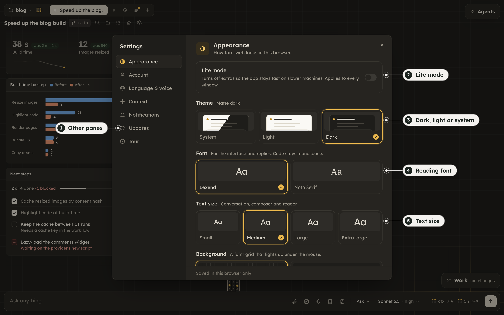

Appearance (theme, font, text size, reply style, click ripple and the app cursor) is saved in the browser. The rest goes to `~/.config/tarcsweb/config.json`, which only you can read:

- Lite mode, from the Appearance pane, so every open window follows it.
- Account: the signed-in Claude and Codex accounts, with sign in and sign out for each.
- Language & voice: the language of generated text (summaries, recaps, notifications) in English or Brazilian Portuguese. The interface stays in English.
- Context: when a long session writes a handoff note and compacts, at 200k, 350k, 500k or 750k tokens, or off to leave it to Claude Code's own auto-compact. The same pane turns side notes on or off for new sessions.
- Notifications: turns on ntfy and creates a random topic for you to subscribe to.
- Updates: your version, Check now and Update.

You can also edit the file by hand. `defaults` sets the permission mode, model and effort that new sessions start with, `voice` sets the Kokoro voice and speed, and `ntfy.server` points at a self-hosted ntfy. Hand edits apply after a restart: `systemctl --user restart tarcsweb` on Linux, or the `launchctl kickstart` line above on macOS.

### Signing in

tarcsweb never asks for your Claude password. When the `claude` CLI is signed out, the app shows a Sign in button that runs `claude auth login`: it opens the sign-in page in your browser, and you paste back the code that page shows. `claude auth login` in a terminal works too.

Codex signs in the same way from Settings > Account with Sign in with ChatGPT, or with `codex login` in a terminal. With only Codex signed in, new tabs start on a Codex model, and the small helper calls (tab titles, summaries, spoken recaps, Ask AI) run on a small GPT model instead of Haiku. Explain and voice input need Claude and stay hidden without it.

### Rendering visuals

Custom pictures and replays need a Chromium-based browser on the machine. The simplest option is `npx playwright install chromium-headless-shell`. An installed `chromium` or `google-chrome` works too, and so does Google Chrome in `/Applications` on macOS.

## Updates

tarcsweb only installs published releases, never the latest commit on a branch. It checks for a new release when it starts and every 6 hours, and a small notice under the gear offers Update, Later and What's new.

An update downloads the new release next to the one you run, builds it and test-starts it on a spare port. Only then does it switch over and restart, and the page reconnects by itself. If any step fails, you keep the version you had, and the reason goes to `~/.cache/tarcsweb/update.log`. To go back to an older version, run `get.sh` with that version; it is still on disk, so nothing is downloaded.

## Uninstall

```sh
~/.local/share/tarcsweb/current/scripts/uninstall.sh
```

This removes the service, the `tarcsweb` command, the app entry and the installed releases. Your config (`~/.config/tarcsweb`) and cache (`~/.cache/tarcsweb`) stay unless you add `--purge`, which on macOS also deletes the logs. The voice files in `~/.local/share/kokoro-tts` are left alone.

## Development

The code is MIT licensed. If a choice here does not suit the way you work, fork it and change it to fit.

You need Node 26 (the server runs its `.ts` files directly) and pnpm.

```sh
pnpm install
pnpm start      # server on 127.0.0.1:24817
pnpm dev:web    # client on 127.0.0.1:24816
```

Then open http://localhost:24816. To run a git clone as the service instead, run `./install.sh` from its folder. A clone updates with git through `scripts/update.sh`; the in-app Update button only works for release installs.

The Node server owns one `Session` per conversation and talks to the browser over a single WebSocket at `/ws`. Vite serves the React client and proxies `/ws` and `/files` to the server.

| Path | What lives there |
| --- | --- |
| `server/protocol.ts` | Wire types shared by server and client |
| `server/config.ts` | The per-user config and its defaults |
| `server/session.ts` | One conversation: SDK query, events, permissions, handoff, MCP toggles, reload |
| `server/sessions.ts` | Open and past sessions, idle CLI limits |
| `server/coldLog.ts` | Older events on disk, history pages and search |
| `server/agents.ts` | Agents panel rows: main thread, subagents, progress and step logs |
| `server/codex/` | Codex app-server client, Codex account, Codex tabs, threads and subagents, image generation |
| `server/mcpHost.ts` | The app's tools served over HTTP MCP to Codex tabs, one token per tab |
| `server/search/` | Full-text index of past conversations, built and queried in worker threads |
| `server/changes.ts` | Per-agent file changes behind the diff cards |
| `server/browser.ts` | The Browser panel's Chrome, its stream and input, and agent routing; recordings in `server/recorder.ts` |
| `server/prompt.ts` | System prompt added to web sessions; re-read on change, applied with Reload on a tab |
| `mods/` | The Claude Code mods behind custom pictures, replays and the Agents panel, and the bundled skills |
| `web/src/store.ts` | zustand store with one batched reducer per burst of events |
| `web/src/ui/` | The ` ```ui ` blocks and their registry |

[CLAUDE.md](CLAUDE.md) has the rules for anyone changing this code, human or agent, including about 30 measured performance rules. [AGENTS.md](AGENTS.md) points other coding agents to the same file.

## License

[MIT](LICENSE). tarcsweb is an independent project and is not made or endorsed by Anthropic.
