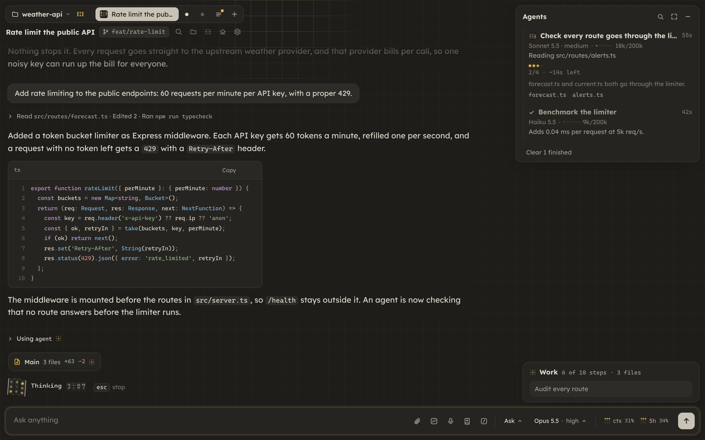

# tarcsweb

Claude Code and Codex in a desktop window or browser tab, running on your own computer.

Each agent session is a tab. A tab runs on Claude Code (through the Agent SDK) or on Codex (through its app-server), and you can keep both open side by side. Your subscriptions, skills, hooks, CLAUDE.md and AGENTS.md files and MCP servers work the same way they do in the terminal. You need only one of the two agents.



## Install

Download the desktop app for your system. It includes Node and Claude Code.

| System | Download |
|---|---|
| Windows | [tarcsweb-windows-x64.exe](https://github.com/TLucas97/tarcsweb/releases/latest/download/tarcsweb-windows-x64.exe), or run `npx tarcsweb` in PowerShell |
| macOS, Apple silicon | [tarcsweb-macos-arm64.dmg](https://github.com/TLucas97/tarcsweb/releases/latest/download/tarcsweb-macos-arm64.dmg) |
| macOS, Intel | [tarcsweb-macos-x64.dmg](https://github.com/TLucas97/tarcsweb/releases/latest/download/tarcsweb-macos-x64.dmg) |
| Linux | [tarcsweb-linux-x64.AppImage](https://github.com/TLucas97/tarcsweb/releases/latest/download/tarcsweb-linux-x64.AppImage) |

Open the app, sign in to Claude under Settings > Account, and pick a folder to work in.

The installers are not signed yet, so the first launch takes one extra click:

- Windows: SmartScreen shows a warning. Click More info, then Run anyway.
- macOS: drag tarcsweb to Applications and open it. If macOS blocks it, click Open Anyway in System Settings > Privacy & Security.
- Linux: make the file executable with `chmod +x tarcsweb-linux-x64.AppImage`, then open it.

Codex is optional. Install its CLI with `npm install -g @openai/codex`, then sign in with ChatGPT from Settings > Account.

### Browser install

On Linux, macOS or WSL2 you can run tarcsweb as a background service and use it in your browser at http://localhost:24816. With Node and npm installed:

```sh
npx tarcsweb
```

Without Node, in a terminal with Bash and curl:

```sh
curl -fsSL https://raw.githubusercontent.com/TLucas97/tarcsweb/main/get.sh | bash
```

Running either command again updates to the latest release.

## Releases

Every version, its notes and its installers are on the [releases page](https://github.com/TLucas97/tarcsweb/releases).

## License

[MIT](LICENSE). tarcsweb is an independent project and is not made or endorsed by Anthropic.
